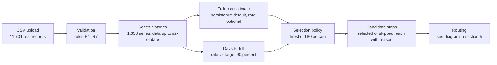
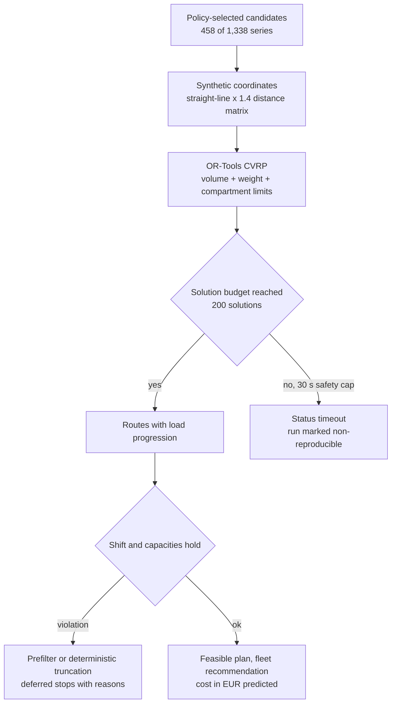

# How WasteRouting.AI works

A short explainer for two audiences: the jury and city officials (plain
language first), and the technical partners who must defend it in Q&A (the
collapsed *Technical detail* block under each section). It describes only
what is implemented in this repository today; every number carries its
source tag and comes from the code, configuration or
[docs/demo_numbers.md](demo_numbers.md).

**Label legend** — **[observed]** verified in the challenge data ·
**[predicted]** model/solver/simulation output · **[representative]** value
given verbally by the challenge representative (14 Nov 2026) ·
**[literature]** sourced external reference · **[demo assumption]** labelled
synthetic default, not from data.

> **Wording note (open):** this document says **records** for the rows of
> the dataset. The app currently labels them *emptying records*; the final
> wording awaits the owner's decision (semantics stated by the project owner
> 14 Nov 2026, written confirmation pending — [open
> question](open_questions.md)).

**Terms used once, then everywhere:** a *series* is one container colour at
one location (1,338 series = 449 locations × 3 colours); *fill level* is the
percent full recorded at a visit; *overfull* is a distinct marker in the raw
data, never a number; a *truck-day* is one truck working one day;
*straight-line distance* is the great-circle (haversine) kilometrage between
two points multiplied by 1.4 — it is **not** road distance.

---

## 1. The problem and what we change

Glass containers today are emptied on a fixed schedule that does not look at
how full they are, and the observed data shows the consequence: 26.9 % of
records show a container full or overfull when it was emptied [observed].
WasteRouting.AI replaces the calendar with a demand-driven plan — estimate
how full each container is from its own history, empty it shortly before it
would overflow, and spread the resulting work across days — which in
simulation needs 342 truck-days where the observed schedule needed 523 over
the same 349-day window (−34.6 % cost, derived; see §5).

Technical detail

The status quo is not a simulated cycle but the observed emptying history
itself: 11,701 visits over 349 days, 229 of them active, median 2 / peak 5
trucks per active day [observed × representative time model]
([schedule profile](schedule_profile.md)). Costing it through the
[representative] time model gives 523 truck-days × 500 EUR = 261,500 EUR;
the day-spread plan simulated on per-container rates gives 342 truck-days =
171,000 EUR with 0.0 % overflow — by construction, the scheduler never
accepts a fill above 100 % (§4.8), so max fill 88.9 % is the emergent
closeness measure [predicted — simulation on observed rates]. All EUR figures are derivations from the
[representative] 500 EUR/truck-day rate, never invoiced amounts
([demo numbers](demo_numbers.md)).

## 2. The data: what is real, what is synthetic, what is unconfirmed

**Real [observed]:** one CSV with 11,701 records — 449 locations, 1,338
series, 2025-10-17 to 2026-09-30, fill levels in steps of ten (0–100 %) plus
the distinct *overfull* marker (1,192 rows). One row records one visit; the
fill level is what was observed at that visit (owner statement, written
confirmation pending). **Synthetic [demo assumption]:** all coordinates (no
location data exists in the CSV), the depot and disposal site near
Heilbronn, and therefore all distances (straight-line × 1.4, never road
distance). **Unconfirmed:** the real fleet, the real forward schedule, the
real density, the meaning of the *overfull* token's magnitude — tracked as
[open questions](open_questions.md) with labelled defaults.

Technical detail

The host supplied a JSON with 109 real glass-container sites, but its
integer site ids have **no join key** to the 449 UUID location ids in the
fill data (open question Q12), so series placement stays synthetic and
real-road routing stays blocked; the JSON is inventoried in the
[data profile](data_profile.md) and deliberately unused. Validation
(contracts [§1](contracts.md)) enforces unique keys, strict dates and
in-range values; invalid rows produce errors, never silent fixes, and
*overfull* is never coerced to a number. A median of 8.4 visits per series
per year [observed] with a 28-day median gap means each series' history is
short — this shapes §3 and §4.

## 3. The prediction pipeline, step by step

From raw records to a work list: upload and validate, group each series'
history, derive two simple estimates per container (current fullness and
fill speed), then apply a threshold rule that selects which containers to
empty. Everything is deterministic — the same data and settings always give
the same answer — and every container ends up either selected or skipped
*with a reason*, never silently dropped.

**Worked example — illustrative only (synthetic container, not from the
data).** A white-glass container with three records: 2026-07-01 at 40 %,
2026-07-29 at 70 %, 2026-08-26 at 60 %.

1. Fill speed: each record's fill divided by the days since the previous
   record gives 70/28 = 2.50 and 60/28 ≈ 2.14 percentage points per day; the
   series' rate is the **median** of these ≈ **2.32 pp/day**.
2. Days to 90 % (the default target [demo assumption]): 90 ÷ 2.32 ≈
   **38.8 days** — assuming the container refills from zero after each
   emptying (model assumption).
3. Predicted full date: 2026-08-26 + 39 days = **2026-10-04**. If that date
   has already passed, the container is shown as *overdue* — dates are never
   shifted to look better.

Technical detail

Exact implemented formulas (contracts [§2](contracts.md),
[src/forecasting/baseline.py](../src/forecasting/baseline.py)):

- **Fullness estimate, *persistence* (default):** the last numeric fill
  level recorded up to the as-of date. If that last record is the *overfull*
  marker, the predicted state is *overfull* and the number falls back to the
  last numeric record — the marker itself is never turned into a number.
- **Fullness estimate, *rate*:** per-series rate × the series' median
  observed interval, clipped to 0–100 %. The rate is the median over records
  *i ≥ 2* with a positive interval of `fill_i / interval_days` — never
  fill-change-between-records, because every record is a visit and fill
  *drops* between visits are the emptyings themselves.
- **Days-to-full:** `target_pct / rate` with target 90 % [demo assumption];
  `predicted_full_date = last visit date + round(days_to_full)`, never
  clamped.
- **Capped values:** records at numeric 100 or *overfull* are *censored
  lower bounds* — true demand was at least this high. They never enter the
  numeric median but set a per-series flag; 66.5 % of the 1,303 real
  estimates carry it [predicted] ([model card](model_card.md)).
- **Sparse history:** fewer than 2 records, zero-length intervals only, no
  numeric fill, or a rate of exactly 0 each produce a reason code instead of
  a number — 35 real series have no estimate, and none is fabricated.
- **Parameters that matter:** selection threshold 80 %, days-to-full target
  90 %, horizon 28 days (all [demo assumption]; the horizon only labels the
  target date — the two estimate values do not depend on it by design).

Real-data result [predicted]: median days-to-full 59.3 days (mean 101.7,
range 6.6–2,313); by colour brown 121.95, green 52.0, white 38.05 — white
and green glass fill much faster and are censored far more often [observed
pattern].

## 4. Honest naming: is this AI?

**No trained machine-learning model exists in this prototype.** The
estimates in §3 are two deterministic statistical methods — *persistence*
and *rate* — plus a division for days-to-full. They are called baselines in
the code and the [model card](model_card.md), and nothing here uses the
words "AI" or "ML" for anything that was not trained, because nothing was.
The forecasting is rate-based statistics, chosen deliberately: each series
has only ~9 records on average (median 8.4 visits/year [observed]) in coarse
ten-percent steps, every number stays explainable to an operator, and any
added complexity must first beat the published, chronologically evaluated
bar — test MAE 20.146 percentage points — which no model has attempted. What
ML could add later: cross-container patterns, seasonality, holiday and
weather effects — as a candidate that must win on the same evaluation first.

Technical detail

Evaluation ([model card](model_card.md), reproduced fresh
2026-11-15 with `python -m src.forecasting.report` on the real CSV):
10,363 cases, chronological split — train < 2026-05-01 (4,571), validation
May–Jul (3,722), test ≥ 2026-08-01 (2,070); random row splits are never
used. Test MAE/RMSE in percentage points on numeric truths only (*overfull*
truths are never coerced): rate 20.146 / 25.857, persistence 22.764 / 30.475
— the rate method wins on both splits. Known cost of the rate method: 15
test cases have no usable rate and are skipped with a reason, never filled
in. MAE of ~20 pp means the forecast is a *prioritisation signal*, not a
precise level gauge.

## 5. The routing algorithm and where the savings come from

Routes are computed by an open-source optimisation solver (Google OR-Tools)
on the classic capacity-constrained vehicle-routing problem: given the
selected containers, find the visiting order and truck assignment that
minimises total distance while respecting volume, weight and per-colour
compartment limits, with unload stops at the disposal site. Time is modelled
flatly — 10 minutes per leg, 5 minutes per container, 30 minutes per
unload, an 8-hour shift [representative values] — and any container that
cannot be served that day is *deferred with a reason*, never dropped.
Savings come from three separable effects: **selection** (visit fewer,
fuller containers — this is what saves time and cost), **ordering** (a
shorter route for the same stops — this saves distance only), and **day
spreading** (leveling work across days so peak days stop needing extra
trucks — this is the main money saver).

Technical detail

Problem type: CVRP with one capacity dimension per material (compartment
volumes) plus total weight (kg = litres × 0.40 kg/L [literature]); disposal
sites are optional unload nodes that reset every dimension. Stops are
droppable with a large penalty so the solver can leave one out, but it then
appears in `unserved` with a deterministic reason — counts reconcile
(served + deferred = total, tested). There is deliberately **no time
dimension in the solver** (a span cap on optional nodes makes OR-Tools fail
at root propagation — observed during development); the 480-minute shift is
enforced after solving by prefiltering impossible round trips and
deterministic truncation, with any residual violation reported, never
hidden. Stopping: a fixed budget of 200 solutions [demo assumption] makes
repeated runs identical (5/5 identical totals in the demo run); the 30 s
wall-clock cap is a safety valve whose runs are honestly labelled
non-reproducible. Demo result [predicted]: 70,175 m over 3 routes, 34 of 458
candidates served, 424 deferred with reasons; fleet recommendation 99 trucks
(volume-bound; 48 by weight). Baselines the solver is compared against
([demo numbers](demo_numbers.md)): naive area-sweep visits of all series
(454,623 m), of policy-selected series (527,021 m) and the fixed-frequency
status quo (355,474 m) — the routing gain is +456,846 m vs the sweep on the
same selection. **Flat-time honesty:** because every leg costs the same 10
minutes, visiting order cannot change total duration — so ordering savings
are reported as distance only, and time/cost savings are attributed to
selection and day spreading ([methodology](routing_methodology.md)).
Day-spreading scheduler (the plan strategy): a container is due when its
projected fill reaches 80 % [demo assumption]; daily capacity is
floor((480 − 2×10 − 30) / (5 + 10)) = 28 stops per truck-day; overflowing
capacity defers the least-urgent containers — except those that would
overflow by tomorrow, which are served same day. Result over the observed
window: 9,237 stops, 342 truck-days, 171,000 EUR, peak 1 truck/day, 0.0 %
overflow (by construction — the same-day guard never accepts a fill above
100 %, §4.8), max fill 88.9 % as the emergent closeness measure, 29,401
deferrals with a longest wait of 29 days [predicted]. The full comparison
also includes a fixed 28-day cycle
(426,000 EUR but 2.4 % overflow) and same-day demand-driven collection
(520,000 EUR — *more* expensive, because rate-synchronised containers come
due together on peak days).

## 6. What affects the results

Every knob below is configurable per request; the UI shows each value's
source tag, and overrides never relabel an assumption as a fact.

| Parameter (default) | Affects | Direction | Source |
|---|---|---|---|
| Selection threshold (80 %) | prediction → routing, cost, service | higher ⇒ fewer stops selected, less collected, higher overflow risk in plans | [demo assumption] |
| Days-to-full target (90 %) | prediction | higher ⇒ later predicted full dates | [demo assumption] |
| Forecast horizon (28 d) | prediction (target-date label only) | estimate values do not depend on it by design | [demo assumption] |
| Container volume (3,000 L) | routing, cost | larger ⇒ more litres/kg per stop ⇒ higher fleet counts | [representative] |
| Density (0.40 kg/L) | routing, cost | higher ⇒ more kg ⇒ weight-bound fleet counts rise | [literature] AVV 20 01 02 |
| Vehicle (12,000 L / 10,000 kg × 3) | routing | bigger ⇒ fewer routes; the ×3 demo cap limits the interactive solve only | [demo assumption] |
| Compartments (equal thirds, 4,000 L) | routing | tighter per-colour caps ⇒ more disposal visits | [demo assumption] |
| Stop service time (5 min) | routing, cost | more minutes ⇒ fewer stops per shift ⇒ more truck-days | [representative] |
| Travel time (10 min flat per leg) | routing, cost | the dominant per-stop cost (15 min cycle); also caps 28 stops/truck-day | [representative] + interpretation (Q4) |
| Disposal unload (30 min) | routing, cost | more ⇒ less usable shift per truck | [demo assumption] |
| Shift (480 min) | routing, cost | longer ⇒ more stops per truck-day | [representative] |
| Truck-day rate (500 EUR, 200 d/yr) | cost | linear on truck-days used | [representative] |
| Fixed-cycle length (28 d) | scenario `fixed_frequency` only | shorter ⇒ more visits, more cost, less overflow | [demo assumption] (Q10) |
| Solver solution budget (200) | routing | larger ⇒ potentially better routes, longer runtime | [demo assumption] |
| Geography seed / spread (0 / 6 km), containers per series (1) | routing | change the synthetic layout and litres per stop — sensitivity only | [demo assumption] |

## 7. Technical decisions and their reasons

- **Rate-based statistics vs trained ML** — *Decision:* persistence + rate
  baselines only. *Alternative:* gradient-boosted/tabular ML. *Reason:*
  ~9 records per series in 10-% steps; explainability requirement; any model
  must beat the tested 20.146 pp MAE bar first. *Limitation:* no learned
  seasonality; ~20 pp MAE bounds precision.
- **Median vs mean for rates** — *Decision:* median of per-record rates.
  *Alternative:* mean. *Reason:* robust to single outlier intervals and
  censored visits. *Limitation:* hides skew — mean days-to-full is 101.7 vs
  median 59.3, so a few very slow containers exist.
- **Censored lower bounds vs coercion** — *Decision:* numeric-100 and
  *overfull* records never become numbers; they flag the estimate
  (`is_lower_bound`). *Alternative:* set 100 or 110 and compute anyway.
  *Reason:* the true value is unknown; inventing one is fabrication.
  *Limitation:* we cannot quantify how much demand is understated (66.5 % of
  estimates are flagged).
- **OR-Tools vs Gurobi** — *Decision:* Google OR-Tools CVRP. *Alternative:*
  licence-bound commercial MILP (the partner prototype used Gurobi).
  *Reason:* open source, runs on the free hosted demo, no evidence exact
  optimality is needed at 1,338-stop scale. *Limitation:* heuristic —
  status is honestly `feasible`, never claimed optimal.
- **Flat time model** — *Decision:* 10 min per leg regardless of distance.
  *Alternative:* distance-derived travel times (implemented, off by
  default). *Reason:* the representative stated 10 minutes between
  containers. *Consequence/limitation:* total duration depends only on stop
  count, so ordering cannot save time — all time/cost claims rest on
  selection and spreading; applying 10 min to depot/disposal legs is our
  interpretation (Q4).
- **Cost definition** — *Decision:* truck-days used × 500 EUR/truck-day
  [representative]; fleet budget secondary. *Alternative:* €/km or €/stop.
  *Reason:* owner-confirmed cost basis ("truck-day cost only").
  *Limitation:* ignores fuel-per-km differences, fixed costs and disposal
  fees; all EUR figures are [predicted] derivations, never invoiced amounts.
- **Determinism / run-to-run variation** — *Decision:* fixed solution budget
  (200) as the stopping criterion; 5-run protocol reports identical-or-range
  distances. *Alternative:* wall-clock time limit. *Reason:* reproducibility
  for auditors; a time-capped run varies with machine load. *Limitation:*
  budget-limited quality, not a proof of optimality; a fired safety-cap
  timeout is labelled non-reproducible.

## 8. Limits and next steps

**What we do not claim:** road distances or real coordinates (none exist in
the data; Q12 blocks both); knowledge of the real fleet, the real forward
schedule, or real costs; precise fill levels (MAE ~20 pp — a prioritisation
signal); that simulations are predictions of reality (they replay observed
rates); seasonality or holiday effects (unevidenced multipliers were
deliberately rejected in the partner-prototype review). Known artefacts are
labelled, e.g. the replay's initialisation synchronises series onto a few
"mega-days", and the simulated median fill at emptying (42.5 %) undershoots
the observed one (60.0 %) — both visible in the app's details panels.

**Validation status:** the two forecast methods are evaluated on a
chronological hold-out with published MAE/RMSE (§4); every route solution is
feasibility-checked (capacities at every stop, reconciled counts, shift
violations surfaced); the observed baseline is arithmetic on real visit
counts, not a simulation. **Not done:** an operational backtest of the
planning rules against real outcomes — there is no counterfactual record of
containers we did *not* visit. *Smallest honest check we propose:* hide each
series' final record, compute days-to-full from the remaining history, and
score whether containers the plan would have flagged "due" actually show
fill ≥ 80 % in the hidden record (precision/recall of the trigger). Uses
only observed data, no field trial.

## 9. Likely questions, short answers

**Is this artificial intelligence?** No trained model exists — the
estimates are deterministic statistics (persistence, fill-rate medians) and
the optimisation is OR-Tools; the name is branding, and nothing is labelled
AI/ML that was not trained.

**Why are the coordinates and distances synthetic?** The dataset contains
no locations; the host's 109-site file has no join key to the 449 data
locations (Q12), so placement stays synthetic and every distance is labelled
straight-line-derived, never road distance.

**Why would demand-driven collection cost *more* than the fixed cycle?** In
simulation it does (520,000 vs 426,000 EUR): containers with similar fill
rates come due together, so peak days need extra trucks. Day spreading fixes
exactly this — 171,000 EUR, the cheapest of all strategies, with zero
overflow by construction (§4.8: the plan never accepts a fill above 100 %;
max fill 88.9 % is the emergent measure).

**Where does the ~35 % saving come from?** The observed schedule needs 523
truck-days over 349 days (261,500 EUR); the day-spread plan needs 342
(171,000 EUR) — −34.6 %, derived — while cutting overflow from the observed
26.9 %-full-or-overfull anchor to 0.0 % in simulation — by construction, not
coincidence (the plan never accepts a fill above 100 %, §4.8). It comes from
leveling work across days and emptying before containers are full, not from
driving faster.

**How good are the fill predictions?** Chronological hold-out test error is
20.1 pp (rate method) / 22.8 pp (persistence) — good enough to rank which
containers need service soon, not a precise gauge; containers without enough
history get a reason instead of a number.

**What if the record semantics turn out different (plain sensor readings
instead of visits)?** The visit semantics are owner-stated and await
written confirmation; if rows were plain readings, the fill-rate formula
would have to change (fill deltas between rows would become meaningful) and
all estimates would be recomputed — the contract keeps this switch cheap,
and nothing is presented as more certain than it is.

**What happens to containers the plan cannot serve that day?** They are
deferred to a later day with a machine-readable reason (capacity, shift,
fleet exhaustion or solver drop); the routing tab lists them, and counts
always reconcile — nothing is silently dropped.

**What would you need from the city to run this for real?** Real container
coordinates and a mapping to the data's location ids (Q6/Q12), depot and
disposal sites, the actual fleet and its capacities (Q1), a road matrix or
measured travel times (Q7), and measured densities (Q2) — each answer
replaces a labelled default in configuration only.

---

*Sources for every figure: [demo numbers](demo_numbers.md) (comparison,
scenarios, observed baseline — live runs 2026-11-15),
[model card](model_card.md) (forecast evaluation, re-run 2026-11-15),
[routing methodology](routing_methodology.md), [schedule
profile](schedule_profile.md), [data profile](data_profile.md), [open
questions](open_questions.md). Contracts and wire formats:
[contracts](contracts.md). How to run it: [user guide](user_guide.md).*
